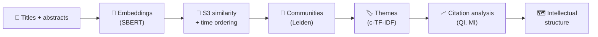
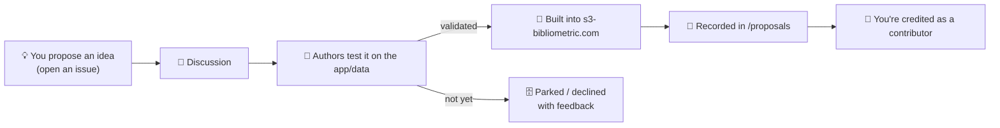

<div align="center">

# S3 — Semantic Similarity Score

**Map the intellectual structure of a research field from what its papers say.**

S3 reads the titles and abstracts of a field's papers, finds its research themes, and shows how
they cite and build on each other. Use it in your browser, from Claude or ChatGPT, in a notebook,
or from Python.

[](https://doi.org/10.1016/j.jbusres.2026.116582)
[](https://pypi.org/project/s3-bibliometric/)
[](https://ai-growth-lab.github.io/S3/)
[](https://s3-bibliometric.com/)
[](LICENSE)

**[Step-by-step guide](https://ai-growth-lab.github.io/S3/)** ·
**[Web app](https://s3-bibliometric.com/)** ·
**[Paper](https://doi.org/10.1016/j.jbusres.2026.116582)** ·
**[Python library](https://github.com/AI-Growth-Lab/s3-bibliometric)** ·
**[Propose an analysis](../../issues/new/choose)**

</div>

---

## 🚀 Start here: pick your way in

You need one file: your search results exported from Scopus as CSV
([how to export, step by step](https://ai-growth-lab.github.io/S3/scopus-export.html)).

| I want to… | Use | How to start |
|---|---|---|
| Get a map in my browser, nothing to install | **Web app** | Upload your export at **[s3-bibliometric.com](https://s3-bibliometric.com/)** (Scopus, Web of Science, Dimensions or OpenAlex) |
| Ask questions in plain language and get a literature-review report | **Claude Desktop or Claude Code** | Add S3 once, then ask *"Run S3 on my Scopus file and build the report"* ([guide](https://ai-growth-lab.github.io/S3/)) |
| Use ChatGPT or Claude.ai in the browser | **One command + upload** | Make the report with one command, then upload it to the chat ([guide](https://ai-growth-lab.github.io/S3/)) |
| Work in a notebook | **Google Colab or Jupyter** | Three cells: install, upload, run ([guide](https://ai-growth-lab.github.io/S3/)) |
| Write my own analysis | **Python library** | `pip install s3-bibliometric` ([docs](https://github.com/AI-Growth-Lab/s3-bibliometric)) |

<details>
<summary><b>Quick start for Python and the command line</b></summary>

```bash
pip install s3-bibliometric
```

```python
import s3bib

res = s3bib.run_s3("scopus.csv", s3bib.S3Config(map_weights="auto"))
res.communities()               # the research themes
res.answer("Q8")                # local vs global foundations of each theme
res.report("s3_report.html")    # the full report, organised for a literature review
```

Or in one command, without installing anything first ([uv](https://docs.astral.sh/uv/) runs it):

```bash
uvx --from s3-bibliometric s3bib report scopus.csv --map auto -o s3_report.html
```

`map_weights="auto"` first checks whether text alone or text plus a citation relation gives the
better map for your data, then uses the better one.

</details>

---

## ✨ What S3 gives you

- **The themes of your field**: communities of papers that say similar things, named by their
  distinctive terms.
- **What to read first**: the central papers of each theme, and its foundations inside the field
  (local citations) and beyond it (global citations).
- **How themes connect**: which themes cite and build on which, and the papers that bridge them.
- **How the field evolves**: growing and declining themes, and how they split over time.
- **Gaps and agenda**: knowledge gaps and emerging themes for your discussion section.
- **Trust in the map**: the threshold choice (SII), coherence against other methods, and outliers
  that do not belong to the field.

With the [Python library](https://github.com/AI-Growth-Lab/s3-bibliometric), all of this comes as
one HTML report organised for a literature review, with a methods paragraph to adapt and reading
lists for Zotero, EndNote or Mendeley.

---

## 🧭 How S3 works

S3 maps a field from *what papers say* rather than *who cites whom*. Citations come back in only to
describe and validate the themes. Full method in [`docs/method.md`](docs/method.md).



1. **Embeddings**: encode each title + abstract with `sentence-transformers/all-mpnet-base-v2`.
2. **S3 matrix + time-masking**: cosine similarity, then orient links by publication date
   (parameter `γ` optionally blends in citations; `γ = 0` is pure semantics).
3. **Community detection**: threshold the graph, partition with **Leiden**, keep the top-*N*
   *Conceptual Building Blocks* (elbow/scree).
4. **Topic characterisation**: label communities from distinctive terms (c-TF-IDF, optional LLM).
5. **Citation analysis**: Quality Index (QI), Maturity Index (MI), local/global citations.
6. **Intellectual structure**: the validated field map.

Metric definitions: [`docs/metrics.md`](docs/metrics.md). Input data and where to get it:
[`docs/data-format.md`](docs/data-format.md).

---

## 💡 Propose a new analysis

S3 already maps themes and their citations. There are many more ways to analyse the same data:
**funding**, author **collaboration**, **geography**, **temporal trends** or **research impact**
across the themes S3 finds. This repository is where you propose them.



1. **Open an [💡 Analysis idea](../../issues/new/choose) issue**: a guided form walks you through it.
2. The community and authors **discuss** whether it is feasible.
3. The authors **prototype and test it** on the app and the underlying data.
4. If it works, it is **built into the app** for everyone, and recorded in [`proposals/`](proposals/README.md).
5. **You are credited** in [`CONTRIBUTORS.md`](CONTRIBUTORS.md) and in the repository's history.

Worked examples: [funding](proposals/examples/0001-funding-analysis.md) and
[geography](proposals/examples/0002-geographic-analysis.md). The full lifecycle, review criteria and
crediting rules are in [`docs/proposal-process.md`](docs/proposal-process.md).

> Not every idea makes it into the app, but every serious proposal gets a fair review and concrete
> feedback.

---

## ❓ FAQ

<details>
<summary><b>Do I need to know how to code?</b></summary>

No. Use the [web app](https://s3-bibliometric.com/), or follow the
[step-by-step guide](https://ai-growth-lab.github.io/S3/) to run S3 from Claude, ChatGPT or a
Colab notebook by copying a few lines.
</details>

<details>
<summary><b>Which data can I use?</b></summary>

A Scopus CSV export works best: title and abstract are required, and references, authors,
affiliations, keywords and funding unlock more of the analysis. The web app also reads Web of
Science, Dimensions and OpenAlex exports; the Python library reads Web of Science and OpenAlex
exports that have Title and Abstract columns. See the
[Scopus export guide](https://ai-growth-lab.github.io/S3/scopus-export.html).
</details>

<details>
<summary><b>Where does my data go?</b></summary>

With the Python library (Claude Desktop, Claude Code, the command line or Jupyter), S3 runs on your
own computer. In Google Colab it runs on Google's servers, and with the web app your file is
uploaded to the app.
</details>

<details>
<summary><b>How is S3 different from citation-based maps?</b></summary>

Bibliographic coupling and co-citation group papers by who they cite, so new papers with few
citations and papers without reference lists are hard to place. S3 groups papers by what they say,
then uses citations to describe and validate the themes. The paper compares S3 with bibliographic
coupling, BERTopic and random clusters (Tables 5–7).
</details>

---

## 📂 Repository structure

<details>
<summary>Show the folders</summary>

```
.
├── README.md                  ← you are here
├── proposals/                 ← 💡 the catalogue of analysis ideas + their status  (start here)
│   ├── README.md              ← index, status legend, how to submit
│   ├── TEMPLATE.md            ← proposal template
│   └── examples/              ← worked example proposals (funding, geography)
├── docs/
│   ├── proposal-process.md    ← the full submit → test → implement → credit lifecycle
│   ├── method.md              ← how the S3 method works
│   ├── metrics.md             ← QI, MI, TCI, Silhouette, citation definitions
│   ├── data-format.md         ← input data and where to get it
│   ├── index.html             ← step-by-step guide (ai-growth-lab.github.io/S3)
│   └── scopus-export.html     ← how to export from Scopus
├── CONTRIBUTORS.md            ← 🎉 people credited for accepted ideas/contributions
├── examples/                  ← implemented analyses (notebooks / outputs)
├── src/                       ← where the open implementation lives (see src/README.md)
├── CONTRIBUTING.md            ← how to contribute (read before submitting)
├── CODE_OF_CONDUCT.md
├── CITATION.cff
├── LICENSE                    ← MIT
└── requirements.txt
```

</details>

---

## 🤝 Contributing

The main way to contribute is to **[propose an analysis](../../issues/new/choose)**. You can also
improve the method, add a worked example from your own field to [`examples/`](examples/README.md),
or fix the docs: see [`CONTRIBUTING.md`](CONTRIBUTING.md). Everyone whose proposal is accepted, or
who contributes code or docs, is credited in [`CONTRIBUTORS.md`](CONTRIBUTORS.md). Please be
respectful: see the [Code of Conduct](CODE_OF_CONDUCT.md).

## 📣 Citation

If you use S3, please cite the paper (also in [`CITATION.cff`](CITATION.cff), which GitHub's
**Cite this repository** button reads):

> Bekamiri, H., Østergaard, C. R., & Timmermans, B. (2027). Semantic similarity score: A new method
> for mapping intellectual structures in business research. *Journal of Business Research*, 219,
> 116582. https://doi.org/10.1016/j.jbusres.2026.116582

<details>
<summary>BibTeX</summary>

```bibtex
@article{bekamiri2027s3,
  author  = {Bekamiri, Hamid and {\O}stergaard, Christian R. and Timmermans, Bram},
  title   = {Semantic similarity score: A new method for mapping intellectual structures in business research},
  journal = {Journal of Business Research},
  volume  = {219},
  pages   = {116582},
  year    = {2027},
  doi     = {10.1016/j.jbusres.2026.116582}
}
```

</details>

## 📜 License

Released under the [MIT License](LICENSE).

## 🙏 Acknowledgements

Created by Hamid Bekamiri and co-authors. The app was built with substantial AI-assisted ("vibe")
coding; community ideas and contributions to extend and strengthen it are warmly welcomed.
